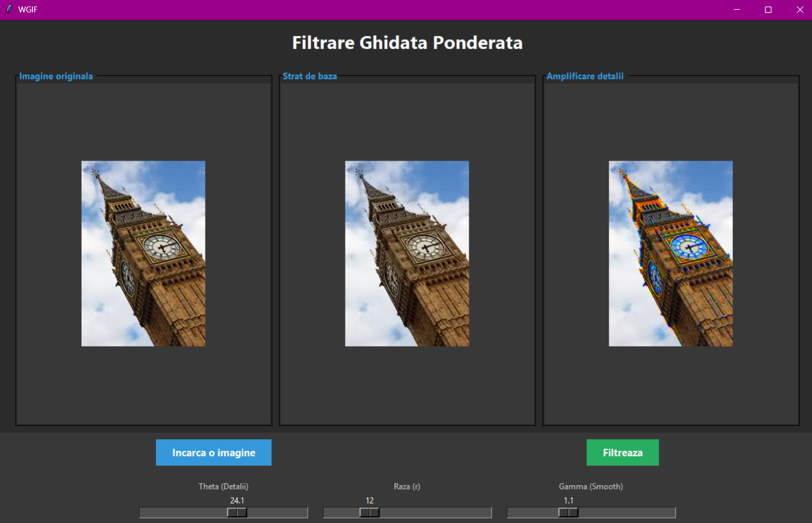
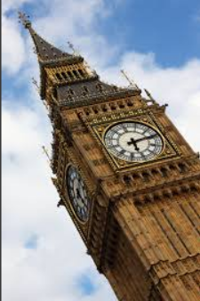

# Weighted Guided Image Filtering (WGIF) in Python

An interactive desktop app that implements **Weighted Guided Image Filtering** to enhance image detail while keeping edges sharp. Load an image, adjust three sliders, and compare the original, the base layer and the enhanced result side by side.



## How it works

The algorithm follows the approach from *Weighted Guided Image Filtering* (Z. Li, J. Zheng, Z. Zhu, W. Yao, S. Wu, IEEE Transactions on Image Processing, 2015).

1. **Edge-aware weighting.** The grayscale image is used as the guide. For each pixel, the local variance in a small 3×3 window is computed and turned into a weight map (gamma): high in detailed or edge regions, low in flat regions. The map is then smoothed with a Gaussian blur.
2. **Weighted guided filter.** Each color channel (B, G, R) is filtered with the guide image. The weight map adapts the regularization term per pixel (`lambda / gamma`), so edges are preserved better than with a standard guided filter. The result is the **base layer**.
3. **Detail layer.** `detail = input - base`
4. **Detail enhancement.** `enhanced = input + eta * detail * theta`, where `eta` is the normalized weight map (so detail is boosted mostly near edges and textures) and `theta` is the amplification factor controlled by a slider.

All local statistics (means, variances, covariances) are computed with vectorized OpenCV and NumPy operations, without per-pixel Python loops.

## Features

- Load any image supported by OpenCV (JPG, PNG, BMP, ...)
- Three-panel view: original image, base layer, enhanced image
- Adjustable parameters:
  - **Theta (Detail):** detail amplification, 1 to 40
  - **Radius (r):** window radius of the guided filter, 3 to 40
  - **Gamma (Smooth):** Gaussian smoothing of the weight map, 0.1 to 3.0
- Layout that resizes images to fit the window

> Note: the interface labels are in Romanian (*Incarca o imagine* = Load image, *Filtreaza* = Filter).

## Example results

| Original | Enhanced |
|---|---|
|  |  |

## Installation

Requires Python 3. Tkinter is included with most Python installations.

```bash
git clone https://github.com/albertizabella12/weighted-guided-image-filtering.git
cd weighted-guided-image-filtering
pip install -r requirements.txt
```

## Usage

```bash
python weighted-guided-image-filtering.py
```

1. Click **Incarca o imagine** and choose an image.
2. Set the sliders. Good starting values are Theta = 4, Radius = 15 and Gamma = 1.0.
3. Click **Filtreaza** to see the base layer and the enhanced image.

## Tech stack

Python, OpenCV, NumPy, Pillow, Tkinter

## Reference

Z. Li, J. Zheng, Z. Zhu, W. Yao, S. Wu. *Weighted Guided Image Filtering.* IEEE Transactions on Image Processing, 24(1), 2015.

## Author

Rebeka-Izabella Albert · [LinkedIn](https://www.linkedin.com/in/rebeka-izabella-albert/)
